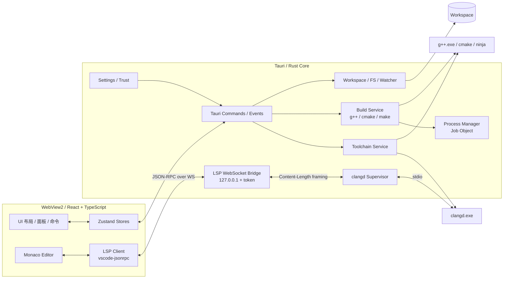

# DevCpp++ 项目计划书

> **定位**：轻量化、现代化、Windows 优先的 C++ IDE  
> **技术路线**：Tauri 2 + Monaco Editor + clangd + GCC（MinGW-w64）  
> **版本**：0.5（M5 P1 体验补齐进行中） · **日期**：2026-10-24 · **状态**：窗口圆角/关闭/实时诊断已修复；文件树拖拽、新建项目向导已接入
> **代码库**：`devcpp-plus-plus`（暂定名）

---

## 0. 一页结论

### 0.1 可行性判断

**结论：技术路线整体合理，建议立项；但必须收敛范围，并修正 5 个关键点。**

这不是一个“把四个成熟组件拼起来”的项目。Tauri、Monaco、clangd、GCC 各自成熟，但**把它们集成为 IDE 的工作量约占 60%–70%**，主要集中在：

- Monaco 没有内置 LSP 客户端，需要自己完成 LSP ⇄ Monaco 的能力映射；
- clangd 与 GCC 不是天然无缝，依赖 `compile_commands.json`、`--query-driver` 和路径/编码处理；
- 构建、运行、进程树管理、交互式输入、调试器都是独立子系统；
- Windows 中文路径、GBK/UTF-8、CRLF 是必须一等公民处理的现实问题（本机已复现 GCC 13 的路径问题，见附录 B）。

### 0.2 评分卡

| 维度 | 评分（1–5） | 说明 |
|---|---:|---|
| 技术可行性 | 4.5 | 组件成熟，集成路径清晰；无不可逾越的底层障碍 |
| 产品差异化 | 3.0 | VS Code/CLion/Dev-C++ 都在；机会在“轻、快、中文友好、开箱即用” |
| “轻量化”目标 | 3.0 | 安装包/启动可做到轻；但 WebView2 + Monaco + clangd 的内存并不轻，必须量化定义 |
| 单人可完成度 | 3.0 | MVP 可行；完整 IDE（调试/终端/Git/跨平台）工作量会迅速失控 |
| 维护成本 | 3.5 | Rust + TS 双栈、LSP 协议演进、Monaco 版本升级都需要持续投入 |
| **综合** | **3.7 / 5** | **值得做，但要以 MVP 和明确的非目标启动** |

### 0.3 必须修正的 5 个关键点

1. **不要用 monaco-languageclient v11 全家桶。**  
   它当前依赖 `@codingame/monaco-vscode-api`（npm 解包约 49 MB，并带大量 language pack），会把 VS Code workbench 级依赖引入项目，与“轻量”目标冲突。建议用 `vscode-jsonrpc` + 自研轻量 LSP 客户端/桥接层，或最多使用 `vscode-ws-jsonrpc` 这类小依赖。

2. **不要用 `@monaco-editor/react` 的默认 CDN loader。**  
   桌面 IDE 不能依赖外网；建议直接集成 `monaco-editor`，自己配置 Vite worker、CSP 和主题。

3. **MVP 明确排除调试器、集成终端、Git、插件系统。**  
   这些是“完整 IDE”功能，不是“能用的 C++ 编辑器”的必要条件。尤其调试器（gdb MI ⇄ DAP）是隐藏的大坑，建议放到 v1.1，并优先评估 `lldb-dap` / MIEngine。

4. **把 Windows 路径与编码当作核心架构问题。**  
   编译器参数必须使用原生反斜杠路径；工作区内含中文时，构建输出目录建议放到 ASCII 缓存目录；文件读写要有编码检测与回写层；LSP 使用 UTF-16 位置编码并规范化 URI。

5. **给“轻量”下可验收的定义。**  
   建议定义为：安装包 ≤ 25 MB、冷启动到可编辑 ≤ 1.5 s、空闲内存 ≤ 250 MB（不含 clangd 索引）、中型项目含 clangd ≤ 600 MB。不要承诺“内存极低”；Tauri 省的是安装包和 Node 运行时，不是 Chromium 内存。

### 0.4 建议的启动方式

```text
第 0 步：1 周技术验证（P0 spike，不写产品代码）
第 1 步：MVP（编辑 + clangd 核心 + 构建运行），8–12 周
第 2 步：可用性硬化 + 打包发布，3–4 周
第 3 步：调试器 / 终端 / Git / 跨平台，按优先级追加
```

**Go / No-Go 条件**：P0 必须验证以下 5 个假设，任一失败都要先调整方案，而不是进入 MVP：

1. Tauri 能稳定拉起 clangd，并通过本机 WebSocket 桥接 LSP，新增延迟可接受；
2. Monaco 能完成增量同步、诊断、补全、悬停、跳转定义；
3. GCC 能在“中文路径 + 空格路径”下完成构建运行（使用原生路径分隔符）；
4. clangd 能通过 `compile_commands.json` + `--query-driver` 正确理解 GCC 项目；
5. 安装包、启动时间、内存基线与目标差距可接受。

---

## 1. 背景、定位与目标

### 1.1 为什么做

现有 Windows C++ 开发工具存在明显空档：

- **Dev-C++**：轻、简单、学生熟悉，但界面和技术栈老旧，代码智能弱，维护不活跃；
- **Visual Studio**：功能强，但安装体积大、启动慢，对教学/刷题场景过重；
- **VS Code + C/C++ 扩展**：通用、强大，但需要配置工具链，C++ 体验依赖扩展，内存和安装体积偏大；
- **CLion**：体验好，但商业授权、资源占用高；
- **Code::Blocks / Qt Creator**：可用，但现代化体验和语言智能不足。

机会点不是“做一个功能更多的 IDE”，而是：

> **一个安装即用、启动快、中文友好、对 MinGW/GCC 友好、具备现代代码智能的 Windows C++ 学习/小项目 IDE。**

### 1.2 目标用户与核心场景

| 用户 | 典型场景 | 最关键需求 |
|---|---|---|
| 学生 / 初学者 | 上课、作业、算法练习 | 新建项目、编译运行、看得懂报错、少配置 |
| 竞赛 / 刷题用户 | 单文件 C++、快速编译运行、标准输入 | 单文件模式、F11 编译运行、外部控制台/输入 |
| 小型 C++ 开发者 | 多文件、CMake、看代码 | clangd 补全/跳转、CMake、格式化、搜索 |
| 教师 / 助教 | 分发示例、检查环境 | 工具链检测、环境诊断、可复现构建 |

### 1.3 产品原则

1. **轻**：不捆绑 Node/Electron 运行时；默认不捆绑 GCC/GDB；安装包和启动时间是硬指标。
2. **快**：窗口先出现，编辑器先可用，clangd 异步启动/索引；不阻塞 UI。
3. **稳**：clangd/构建进程崩溃可恢复；进程树可回收；文件保存原子化。
4. **可解释**：工具链状态、clangd 状态、构建命令、错误原因都可见，不把失败藏在日志里。
5. **不锁定工具链**：检测系统 GCC/Clang/CMake/Ninja；允许用户覆盖路径。
6. **中文优先**：中文 UI、中文路径、GBK 文件、CRLF、中文输入法都要纳入测试矩阵。

### 1.4 成功指标（MVP）

| 指标 | 目标 |
|---|---|
| 安装包（NSIS，在线 WebView2） | ≤ 25 MB |
| 冷启动到可编辑 | ≤ 1.5 s（中端 SSD） |
| 空闲内存（无 clangd 索引） | ≤ 250 MB |
| 中型项目含 clangd | ≤ 600 MB |
| 补全延迟（clangd 热态） | p95 ≤ 500 ms |
| 中文路径项目构建/运行 | 100% 通过测试矩阵 |
| 1 小时编辑会话 | 无未处理崩溃；clangd 崩溃可自动恢复 |
| 首次使用 | 无需读文档即可完成“打开/新建 → 写代码 → 编译运行” |

### 1.5 非目标（MVP 明确不做）

- 调试器（断点/单步/变量/调用栈）
- 集成终端（ConPTY + xterm.js）
- Git 集成
- 插件/扩展市场
- AI 补全/对话
- 远程开发、多根工作区、协作
- MSVC 工具链（后续）
- C++20 Modules 的完整支持
- 自研编译器/语言服务器
- 完整重构（extract function 等）——只做 clangd 已有能力

> **范围冻结规则**：MVP 期间新增需求进入 `Backlog`，不进入当前里程碑；除非它阻塞核心闭环。

---

## 2. 技术方案合理性评估

### 2.1 四个组件的职责边界

| 组件 | 在项目中的职责 | 不负责什么 |
|---|---|---|
| **Tauri 2** | 窗口、生命周期、IPC、文件/进程访问、打包、更新 | 编辑器、语言智能、构建系统 |
| **Monaco Editor** | 文本模型、编辑交互、语法高亮、Diff、部分语言 UI | 进程管理、LSP 传输、文件系统 |
| **clangd** | C++ 解析、诊断、补全、跳转、格式化、重命名、语义信息 | 编译链接、调试、项目构建 |
| **GCC (MinGW-w64)** | 编译、链接、生成可执行文件 | 代码智能、调试协议 |

**缺失但必须自建的部分**：LSP 客户端、LSP 传输桥、构建编排、`compile_commands` 生成、文件监视、编码层、设置系统、工具链检测、问题面板、输出面板、调试适配（后续）、终端（后续）、安装器与更新。

### 2.2 逐项评估

#### Tauri 2 —— 合理，但不要误解“轻量”

**优点**

- 安装包显著小于 Electron；无 Node 运行时；
- Rust 后端非常适合管理 clangd/GCC/GDB 子进程、文件监视、WebSocket、进程树；
- Windows 上使用系统 WebView2，Win10/11 通常已预装；
- 权限模型（capabilities）比 Electron 默认更收敛；
- 打包（NSIS/MSI）、单实例、文件关联、更新生态完整。

**风险/限制**

- WebView2 仍是 Chromium 多进程架构，**内存不会比 Electron 低一个数量级**；
- Rust 编译慢，迭代成本高于 Node；
- WebView2 版本差异、GPU/IME/高 DPI 问题需要实测；
- Windows 未签名安装包会触发 SmartScreen；
- Tauri 的 IPC/事件适合业务消息，不适合直接把 LSP 高频 JSON-RPC 全走 IPC（可用，但 WebSocket 更简单）。

**结论**：若“轻量”指安装体积和启动速度，Tauri 合理；若指内存极低，应重新评估原生 UI 或更轻的编辑器方案。

#### Monaco Editor —— 合理，但要自己接 LSP

**优点**

- IDE 级编辑体验：多光标、查找替换、Diff、面包屑、折叠、括号着色、便签滚动、无障碍；
- C++ 语法高亮开箱可用；
- 可通过 provider 接入 LSP 的诊断、补全、悬停、跳转、引用、符号、格式化、重命名、代码操作、语义 token；
- 与 VS Code 同源，用户熟悉。

**风险/限制**

- npm 包解包约 100 MB（含全语言和 source map），按需构建后仍是 MB 级产物；
- 需要正确配置 worker、CSP、Vite 构建；
- **没有内置 LSP 客户端**；`monaco-languageclient` 新版又过重；
- 语义高亮、Inlay Hints、调用层级等没有现成 UI，需要自研；
- 大文件/超长行需要限制和优化。

**结论**：Monaco 是正确选择；集成方式要“直接、按需、轻依赖”，不要套 VS Code workbench。

#### clangd —— 合理，且是当前最佳开源选择

**优点**

- LLVM 官方维护，活跃、跨平台、Apache-2.0 WITH LLVM-exception；
- C++ 补全/诊断/跳转/重命名/格式化/语义 token 完整；
- 支持 `compile_commands.json`，可通过 `--query-driver` 查询 GCC 的系统头文件；
- 可作为独立进程运行，崩溃不拖垮 IDE；
- 与 GCC 编译的项目可以协作。

**风险/限制**

- **clangd 不是 GCC**：它用 Clang 前端解析；GCC 特有扩展、某些内建函数、pragma、旧代码可能产生与 GCC 不一致的诊断；
- 没有 `compile_commands.json` 时体验显著下降（可用 `compile_flags.txt` 兜底）；
- `--query-driver` 会让 clangd 执行匹配的编译器以获取系统 include 路径，必须限制白名单；
- 索引大项目时 CPU/内存占用高，需要开关和限制；
- clangd 崩溃/卡死需要 supervisor 自动重启；
- 版本与项目配置（`.clangd`、`.clang-tidy`）需要暴露给用户。

**结论**：clangd 是最合适的语言服务器；但“GCC + clangd = 完美”是误解，必须通过 compile_commands、query-driver 和测试矩阵保证体验，并保留 LLVM clang 工具链作为 Tier 2。

#### GCC (MinGW-w64) —— 合理，但 Windows 上是“有历史包袱的必需项”

**优点**

- Windows C++ 教学/竞赛最熟悉的工具链；
- MSYS2/MinGW-w64 安装方便，GDB 配套成熟；
- GCC 13.2 已支持 C++20/23 的大部分特性；
- 生成原生 Windows 可执行文件，调试信息为 DWARF，GDB 可读。

**风险/限制**

- Windows 路径/编码处理不如 LLVM 工具链稳定；**本机已复现：GCC 13.2 + 正斜杠 + 中文输出路径会导致 ld 无法创建文件**（见附录 B）；
- 编译出的 exe 依赖 `libstdc++-6.dll`、`libgcc_s_seh-1.dll` 等，直接双击可能缺 DLL；
- GDB 的 DAP 集成不如 LLDB 原生 `lldb-dap`；
- MSYS2 UCRT64 / MinGW64 / Clang64 多个环境容易混用，导致 DLL 冲突；
- GCC 的 GPL 许可证意味着**不建议随安装包捆绑 GCC/GDB**。

**结论**：GCC 作为 Tier 1 编译器保留；构建参数使用原生路径；默认静态链接运行库或为运行进程注入工具链 PATH；不捆绑 GCC/GDB，改为检测 + 引导安装。

### 2.3 关键反直觉点

1. **“接上 clangd 就有 IDE”是假的。**  
   LSP 只提供协议；补全列表如何渲染、诊断如何映射、WorkspaceEdit 如何应用、语义 token 如何配色，全部要写。MVP 至少涉及 15+ 个 LSP 方法和大量边界情况。

2. **`monaco-languageclient` 最新版不是“轻量封装”。**  
   它把 VS Code 的 workbench/service 体系引入浏览器，适合“在浏览器里复刻 VS Code”，不适合“轻量 C++ IDE”。自研客户端反而更小、更可控。

3. **clangd + GCC 不是无缝组合。**  
   clangd 能读 GCC 的 compile_commands，但解析器是 Clang。对 GCC 扩展的误报要用 `.clangd` 配置、编译数据库质量、以及“以构建结果为准”的产品话术来兜底。

4. **调试器是最容易低估的部分。**  
   gdb MI 到 DAP 的映射涉及线程、栈帧、变量、表达式、pretty printer、断点、异常、异步事件。自研至少数周；优先考虑现成 DAP adapter。

5. **交互式输入不是“输出面板”能解决的。**  
   `cin` 程序需要控制台/PTY。MVP 用“输出面板 + stdin 文本框”和“外部控制台”两条路，集成终端放后面。

6. **中文路径/GBK 是 Windows 的必答题。**  
   不是边缘 case；本机用户目录就含中文。路径分隔符、URI 编码、文件编码、编译器消息编码、控制台代码页都会影响体验。

7. **“轻量”是相对概念。**  
   Tauri 省安装包，不省 Chromium 内存；clangd 索引大项目时内存可能超过编辑器本身。必须在 UI 中暴露 clangd 状态和索引开关。

### 2.4 备选方案对比

#### Tauri vs Electron vs 原生

| 维度 | Tauri 2 | Electron | 原生 (Qt) |
|---|---|---|---|
| 安装包 | 小（10–25 MB 级） | 大（80–150 MB 级） | 中 |
| 冷启动 | 较快 | 较慢 | 最快 |
| 内存 | 中（WebView2） | 中高（Chromium + Node） | 低–中 |
| UI 开发效率 | 高（Web） | 高（Web） | 中 |
| 进程/系统集成 | Rust 强 | Node 方便 | 最强 |
| 生态/调试 | 较新 | 最成熟 | 成熟 |
| 结论 | **选择** | 备选 | 不选（UI 迭代慢） |

#### Monaco vs CodeMirror 6

| 维度 | Monaco | CodeMirror 6 |
|---|---|---|
| IDE 体验 | 强（Diff/面包屑/多光标/无障碍） | 基础好，需自建更多 UI |
| 体积 | MB 级 | 数百 KB 级 |
| LSP 接入 | 需要自研 provider 映射 | 同样需要自研 |
| 结论 | **选择 Monaco**（IDE 属性优先） | 若“绝对轻量”优先可考虑 |

#### clangd vs ccls vs cpptools

| 方案 | 结论 |
|---|---|
| **clangd** | **选择**：活跃、跨平台、许可证友好、独立进程 |
| ccls | 较老，生态弱，不选 |
| cpptools / IntelliSense | 与 VS Code 绑定，第三方 IDE 嵌入的许可证/分发风险高，不选 |

#### GCC vs Clang

| 方案 | 结论 |
|---|---|
| **GCC (MinGW-w64)** | **Tier 1**：用户熟悉、教学/竞赛主流；需处理路径/DLL/调试差异 |
| **LLVM/Clang** | **Tier 2（推荐同时支持）**：clangd/clang-format/lldb-dap 同源，Unicode 路径更稳，调试集成更简单 |
| MSVC | 后续；Tauri 本身用 MSVC 构建，但 C++ 项目工具链另算 |

### 2.5 可行性结论

- **技术可行性：高。** 没有底层不可解问题；风险在集成质量和范围控制。
- **产品可行性：中。** 市场存在空档，但用户对“又一个 C++ IDE”的耐心有限；必须把“开箱即用 + 中文友好 + 轻快”做到明显优于 Dev-C++/VS Code 配置流。
- **单人可行性：MVP 可行，完整 IDE 不可行。** 以 1 名有经验的开发者全职计算，MVP 约 8–12 周；完整 v1（含调试器、终端、跨平台）约 4–6 个月；业余每周 10 小时约 8–12 个月，每周 15 小时约 6–8 个月。
- **建议：立项，但先做 1 周 P0，再决定是否进入 MVP。**

---

## 3. 总体架构

### 3.1 架构图



### 3.2 进程模型

```text
DevCpp++.exe (Tauri/Rust)
├─ WebView2 (多个 Chromium 进程)
├─ clangd.exe              每个工作区一个，stdio 由 Rust 桥接
├─ g++.exe / cc1plus / ld  构建时短生命周期
├─ cmake.exe / ninja.exe   构建时短生命周期
├─ 用户程序.exe            运行/调试时
└─ (后续) gdb.exe / lldb-dap.exe
```

原则：

- **一个工作区一个 clangd**；切换工作区时优雅关闭旧实例。
- 所有子进程使用 **Job Object / 进程组**，应用退出时确保整棵进程树被回收。
- clangd 的 stderr 单独写日志，不混入 LSP 通道。
- 构建/运行进程的 stdout/stderr 以流式事件送到前端，限制缓冲，避免 UI 卡死。

### 3.3 数据流

#### 打开文件

```text
UI 点击文件
→ Tauri command read_file(path)
→ Rust 读取字节，检测 BOM/编码/EOL
→ 解码为 UTF-8 字符串 + 元数据
→ 前端创建 Monaco model（设置 language/eol）
→ LSP didOpen（文本用 \n 规范化）
→ clangd 解析并 publishDiagnostics
→ 前端 setModelMarkers
```

#### 编辑与补全

```text
Monaco onDidChangeModelContent
→ 映射为 LSP incremental didChange（UTF-16 位置）
→ WS → Rust 桥 → clangd
Monaco 触发 completion
→ LSP textDocument/completion
→ 映射 CompletionItem / textEdit / additionalTextEdits
→ Monaco 渲染补全
```

#### 构建与运行

```text
UI 点击“编译运行”
→ Tauri command build(...)
→ Rust 解析构建模式（单文件/CMake/项目文件）
→ 生成/定位 compile_commands.json
→ 以参数数组启动 g++（原生路径、无 shell）
→ stdout/stderr 流式事件 → 输出面板
→ 构建成功后启动 exe（输出面板或外部控制台）
→ 退出码/耗时/可执行文件路径返回
```

### 3.4 前端架构

- **React 19 + TypeScript + Vite**：UI 与编辑器容器。
- **Zustand**：轻量状态管理；只存元数据（打开的文件、dirty、编码、诊断计数、布局），**不复制 Monaco 文本内容**。
- **Monaco 直接集成**：`monaco-editor` + 按需引入 C++ 语言贡献 + 自定义 worker；不使用 `@monaco-editor/react` 的 CDN 默认加载。
- **LSP Client 模块**：传输（WebSocket）→ 连接（`vscode-jsonrpc`）→ 能力注册（providers）→ 特性模块（diagnostics/completion/...）。
- **组件分区**：Explorer / Editor Tabs / Problems / Output / Status Bar / Command Palette / Settings / Onboarding。
- **样式**：CSS 变量 + 轻量组件，不引入大型 UI 框架；图标用 Lucide（ISC）。
- **i18n**：zh-CN / en-US；错误码在前端本地化，Rust 返回结构化错误码而非直接展示文案。

### 3.5 后端架构（Rust）

| 模块 | 职责 |
|---|---|
| `commands/` | Tauri command 入口，参数校验，调用服务 |
| `state.rs` | 全局状态：设置、工作区、LSP 会话、进程表 |
| `workspace/` | 打开/关闭工作区、最近项目、目录列表、文件操作 |
| `fs/` | 原子读写、编码检测、文件监视、外部变更 |
| `toolchain/` | 检测 GCC/GDB/clangd/CMake/Ninja，版本解析、配置档案 |
| `lsp/` | clangd 生命周期、WS 服务、Content-Length framing、supervisor |
| `build/` | 构建模式、命令构造、compile_commands 生成、输出解析 |
| `process/` | 子进程启动/取消/进程树回收/流式输出 |
| `settings/` | JSON 设置、迁移、项目级覆盖 |
| `security/` | 工作区信任、路径规范化、CSP 辅助、token |
| `debug/`（后续） | DAP 客户端桥、调试适配器管理 |

技术要点：

- `tokio` 异步运行时；Tauri command 使用 `async`；
- 共享状态用 `RwLock`/`Mutex`，但**不要跨 await 持锁**；
- 所有错误用 `thiserror` 定义，序列化为 `{ code, message, details }`；
- 长任务（构建、clangd、索引）用事件推送，不阻塞 command；
- 退出时统一 `shutdown_all()`：LSP shutdown → 等待 → kill；构建进程树 kill。

### 3.6 关键设计决策（ADR 预告）

| ADR | 决策 | 状态 |
|---|---|---|
| ADR-0001 | Tauri 2 而非 Electron | 建议采纳 |
| ADR-0002 | Monaco 直接集成，不用 monaco-languageclient v11 | 建议采纳 |
| ADR-0003 | LSP 走 loopback WebSocket，而非 Tauri IPC | 建议采纳，P0 验证 |
| ADR-0004 | clangd + GCC，compile_commands 为生命线 | 建议采纳 |
| ADR-0005 | MVP 不含调试器；v1.1 评估 lldb-dap / MIEngine | 待 P0 后决策 |
| ADR-0006 | 不捆绑 GCC/GDB；可选 LLVM 工具包 | 建议采纳 |
| ADR-0007 | Windows 原生路径 + 编码层 | 必须采纳 |
| ADR-0008 | 构建模式：单文件 + CMake + 可选项目文件 | 建议采纳 |

---

## 4. 关键子系统设计

### 4.1 LSP 桥（核心风险点）

#### 为什么用 loopback WebSocket

- 浏览器/WebView 不能直接 spawn 进程；
- LSP 是双向、低延迟、高频消息，WebSocket 的请求/通知模型天然匹配；
- Tauri IPC 也能做，但需要自定义 MessageReader/Writer，且事件序列化开销/调试体验不如 WS；
- loopback WS 不暴露到局域网，配合随机 token 和 Origin 校验即可。

#### 拓扑

```text
Monaco ⇄ vscode-jsonrpc ⇄ WebSocket (ws://127.0.0.1:<port>/lsp?token=...)
       ⇄ Rust tokio-tungstenite ⇄ Content-Length framing ⇄ clangd stdin/stdout
```

#### 生命周期

```text
start_lsp(workspace)
  → 选择 clangd 路径/参数
  → 绑定 127.0.0.1:0，生成 32 字节随机 token
  → spawn clangd（stdin/stdout piped，stderr 日志）
  → 返回 { port, token, sessionId }
  → 前端连接 WS，发送 initialize / initialized
  → 正常工作
stop_lsp:
  → shutdown request → 等待 exit（2 s）→ kill 进程树
异常:
  → 初始化超时 10 s → kill/重启
  → 进程退出 → 指数退避重启（最多 3 次/60 s）
  → 连续失败 → 停用 LSP，显示可操作的错误横幅
```

#### Framing 规则

- 读取 `Content-Length: N\r\n`（允许附加头），再读 N 字节 JSON；
- 处理：分片读取、一次读到多条消息、非法/缺失长度、超大消息（上限 64 MB）；
- WS 文本帧传 JSON；Rust 桥只做 framing，不解析业务语义（initialize 等原样透传）；
- 写入串行化，避免多线程交错；
- 记录消息方向/类型/大小/耗时（可开关），**默认不记录完整源码内容**；
- 编码统一 UTF-8；JSON 中的源码文本由前端规范化。

#### 安全

- 仅绑定 `127.0.0.1`；
- 随机 token（URL query 或首条消息），校验失败立即关闭；
- 校验 Origin（Tauri 生产 `http://tauri.localhost`，开发 `http://localhost:1420`；以实际为准）；
- 单连接；窗口关闭/工作区切换时主动断开；
- 不使用 `0.0.0.0`；不提供远程访问；
- 如企业安全软件阻止本地监听，回退方案：Tauri Channel/Events 传输（P0 不实现，仅预留接口）。

#### clangd 启动参数（建议基线）

```text
clangd
  --background-index
  --clang-tidy
  --completion-style=detailed
  --header-insertion=iwyu
  --compile-commands-dir=<工作区或 .devcpp 目录>
  --query-driver=<检测到的 g++/gcc 绝对路径>
  --log=info
  --pretty
```

说明：

- `--compile-commands-dir` 仅在数据库不在工作区根目录时传；
- `--query-driver` 只允许“检测到的工具链路径”，**禁止**项目设置任意指定；
- 路径建议用正斜杠或原生路径需 P0 实测；query-driver 的 glob 在 Windows 上有细节差异；
- 额外参数由设置暴露，但做基本校验；
- `.clangd` / `.clang-tidy` / `.clang-format` 由 clangd 自动读取，IDE 只负责显示与打开。

### 4.2 前端 LSP 客户端与 Monaco 映射

#### 依赖选择

- **`vscode-jsonrpc`（约 228 KB 解包）**：成熟的 JSON-RPC 连接、请求/通知、取消、错误处理；
- **`vscode-ws-jsonrpc`（约 56 KB 解包）**：可选的 WebSocket reader/writer；若其 API 与当前 `vscode-jsonrpc` 版本不匹配，自己实现约 80 行 transport 即可。注意：`vscode-ws-jsonrpc@4.0.3` 依赖 `vscode-jsonrpc@9.x`，若使用它请锁定 9.x，避免同时出现 9/10 两个版本；
- **不使用 `monaco-languageclient` v11**；若未来需要，最多评估 v8 或自研。

#### 功能映射（MVP → 后续）

| 功能 | LSP 方法 | Monaco API | 阶段 |
|---|---|---|---|
| 诊断 | `textDocument/publishDiagnostics` | `monaco.editor.setModelMarkers` | MVP |
| 补全 | `textDocument/completion` + `completionItem/resolve` | `registerCompletionItemProvider` | MVP |
| 悬停 | `textDocument/hover` | `registerHoverProvider` | MVP |
| 跳转定义 | `textDocument/definition` | `registerDefinitionProvider` | MVP |
| 引用 | `textDocument/references` | `registerReferenceProvider` + 面板 | MVP（基础列表）/P1（peek/分组） |
| 文档符号 | `textDocument/documentSymbol` | `registerDocumentSymbolProvider` | MVP |
| 格式化 | `textDocument/formatting` | `registerDocumentFormattingEditProvider` | MVP |
| 重命名 | `textDocument/prepareRename` + `rename` | `registerRenameProvider` | P1 |
| 代码操作 | `textDocument/codeAction` + `codeAction/resolve` | `registerCodeActionProvider` | P1 |
| 签名帮助 | `textDocument/signatureHelp` | `registerSignatureHelpProvider` | P1 |
| 文档高亮 | `textDocument/documentHighlight` | `registerDocumentHighlightProvider` | P1 |
| 折叠 | `textDocument/foldingRange` | `registerFoldingRangeProvider` | P1 |
| 工作区符号 | `workspace/symbol` | Quick Pick | P1 |
| 语义高亮 | `textDocument/semanticTokens/full` | `registerDocumentSemanticTokensProvider` | P1 ✅ |
| Inlay Hints | `textDocument/inlayHint` | 自定义装饰器 | P2 |
| 选择范围 | `textDocument/selectionRange` | `registerSelectionRangeProvider` | P2 |
| 调用层级 | `prepareCallHierarchy` 等 | 自定义树 | P3 |
| 文件状态 | `textDocument/clangd.fileStatus` | 状态栏 | MVP |
| 进度 | `$/progress` + `window/workDoneProgress/create` | 状态栏 | P1 |
| 应用编辑 | `workspace/applyEdit` | 前端/后端应用 | P1 |
| 配置 | `workspace/configuration` | 返回设置 | P1 |

#### 同步与位置

- **位置编码**：初始化时声明 `general.positionEncodings = ["utf-16"]`；Monaco 列号就是 UTF-16 code unit，直接映射；
- **增量同步**：clangd 通常宣告 `TextDocumentSyncKind.Incremental`；把 Monaco 的变更映射为 LSP `contentChanges`，注意 Monaco 是 1-based、LSP 是 0-based；
- **文本规范化**：发送给 LSP 的文本统一 `\n`；文档元数据单独保存原始 EOL（CRLF/LF），保存时恢复；
- **URI**：Windows 盘符大写、`file:///D:/...`、中文/空格/`#`/`%` 百分号编码；建议前端用 `vscode-uri`，Rust 用 `url`；
- **路径**：Rust 侧避免 `\\?\` 前缀（用 `dunce` 或手动剥离），否则 clangd/GCC 可能不识别；
- **大小写**：Windows 路径比较不区分大小写；诊断/引用按规范路径聚合；
- **版本号**：每个文档维护 LSP version；忽略过期的诊断/补全响应；
- **取消**：Monaco 取消补全时发送 `$/cancelRequest`；不要对已取消请求报错；
- **错误**：用户主动操作失败 → toast；后台失败 → 日志 + 状态栏，不打断编辑。

#### 诊断映射

| LSP severity | Monaco MarkerSeverity |
|---|---|
| 1 Error | `MarkerSeverity.Error` |
| 2 Warning | `MarkerSeverity.Warning` |
| 3 Information | `MarkerSeverity.Info` |
| 4 Hint | `MarkerSeverity.Hint` |

同时映射 `tags`（Unnecessary/Deprecated）、`relatedInformation`、`code`、`source`；Problems 面板按文件分组，点击跳转。

#### 补全细节（易踩坑）

- `CompletionList` vs `CompletionItem[]`；
- `textEdit` 可能是 `TextEdit` 或 `InsertReplaceEdit`；
- `additionalTextEdits`（自动 include）需要与主编辑一起应用，注意冲突；
- `insertTextFormat = Snippet` 映射为 `InsertAsSnippet`；
- `triggerCharacters` 从 server capabilities 读取，不硬编码；
- `resolve` 懒加载文档，避免大列表卡顿；
- `isIncomplete` 时 Monaco 会重新请求；
- 过滤 `sortText`/`filterText`/`labelDetails`；
- 中文/非 BMP 字符的列号是 UTF-16，注意与 JS string 索引一致。

#### WorkspaceEdit（重命名/代码操作）

三种情况：

1. 仅当前打开文件：前端直接 `pushEditOperations`；
2. 多文件且都已打开：逐 model 应用，检查版本；
3. 涉及未打开文件：Rust 后端在磁盘上原子应用（批量临时文件+rename），前端刷新已打开 model；
4. 有未保存冲突：提示保存/放弃，不要静默覆盖；
5. 应用失败：返回 `{ applied: false, failureReason }`，clangd 会显示失败。

### 4.3 构建与运行系统

#### 构建模式

| 模式 | 适用 | 行为 |
|---|---|---|
| **单文件** | 刷题、示例、初学者 | 编译当前活动 `.cpp`，输出到构建目录，运行 |
| **CMake** | 多文件、正规项目 | 检测 `CMakeLists.txt`，配置（导出 compile_commands），构建目标 |
| **项目文件（可选）** | 无 CMake 的多文件教学项目 | `.devcpp/project.json` 列出 sources/include/flags |
| **Makefile（可选）** | 已有项目 | 调用 `mingw32-make`/`make` |

自动检测顺序建议：`CMakeLists.txt` → `.devcpp/project.json` → 单文件。

#### compile_commands 策略（clangd 的生命线）

优先级：

1. 工作区已有 `compile_commands.json`：直接用；若在 `build/`，传 `--compile-commands-dir=build`；
2. CMake 项目：配置时 `-DCMAKE_EXPORT_COMPILE_COMMANDS=ON`，生成到构建目录；
3. 单文件/项目文件：在 `.devcpp/compile_commands.json` 生成，**不覆盖用户根目录文件**；
4. 兜底：`compile_flags.txt`（仅简单 flags，不含每文件差异）。

生成时使用 `arguments` 数组而非 `command` 字符串，避免 Windows 引号/空格转义问题。示例：

```json
[
  {
    "directory": "D:\\work\\hello",
    "file": "D:\\work\\hello\\src\\main.cpp",
    "arguments": [
      "D:\\msys64\\ucrt64\\bin\\g++.exe",
      "-std=c++20",
      "-ID:\\work\\hello\\include",
      "-c",
      "D:\\work\\hello\\src\\main.cpp"
    ]
  }
]
```

注意：

- `arguments` 中路径使用原生反斜杠；JSON 中写成 `\\`；
- `file` 用绝对路径；`directory` 用工作目录；
- clangd 侧可能需要正斜杠/URI 归一化，P0 实测两种写法；
- 数据库变化（保存/构建/切换 flags）后，通知 clangd 重新加载或重启；
- 用户手改 `compile_commands.json` 时不要覆盖，监听变更并提示。

#### 命令构造规则（Windows 重点）

- **绝不通过 shell**；一律 `Command::new(exe).args(args)`，避免注入与引号问题；
- **编译器参数使用原生路径**（`Path`/`OsStr`），不要手工拼 `/`；
- **中文输出路径**：优先把构建目录放到 ASCII 路径（如 `%LOCALAPPDATA%\devcpp-plus-plus\build\<hash>`），或至少用原生反斜杠；
- 本机实测：GCC 13.2（MSYS2 UCRT64）在“正斜杠 + 中文输出路径”下 ld 失败；反斜杠成功（附录 B）；
- 为子进程设置环境：
  - `PATH` 前置工具链 bin（保证 GCC 的 DLL 与运行库可找到）；
  - `LC_ALL=C` / `LANG=C`（尽量让 GCC 输出英文，便于解析/检索）；
  - 保留用户环境变量；不要继承无关的 `MSYS2` 变量导致混用；
- 工作目录设为项目根或构建目录；
- `CREATE_NO_WINDOW` 捕获输出；`CREATE_NEW_CONSOLE` 用于交互运行；
- 用 Job Object（`command-group` 或 `windows` crate）确保取消/退出时杀掉整棵进程树；
- 构建输出用环形缓冲（如 10,000 行）+ 批量事件（50 ms），避免高频 IPC 卡 UI。

#### 运行策略

| 场景 | 方案 |
|---|---|
| 普通输出 | 捕获 stdout/stderr，显示在输出面板 |
| 需要 stdin（批量） | 输出面板下方提供输入框，写入 stdin 后关闭 |
| 交互式 `cin`/菜单 | 外部控制台（`CREATE_NEW_CONSOLE`）或后续集成终端 |
| 运行后暂停 | 外部控制台会随程序退出关闭；后续用小型 runner helper 显示“按回车退出” |
| 缺少 DLL | 运行时 PATH 前置工具链 bin；或默认 `-static-libgcc -static-libstdc++` |

**建议默认**：Windows 上默认加 `-static-libgcc -static-libstdc++`，让 exe 可独立运行；提供设置关闭。构建/运行时仍将工具链 bin 加入 PATH，双保险。

#### 构建错误展示

- MVP：输出面板原样显示，保留 ANSI 颜色（或去除），支持复制；
- P1：解析 GCC 诊断（`file:line:col: error: ...`），映射到 Problems 面板；设置 `LC_ALL=C` 提高稳定性；
- 不依赖解析来判定构建成功：**以退出码为准**；
- 构建失败时自动展开输出面板，显示命令全文（可复制）；
- 成功时状态栏短暂显示耗时/产物路径。

### 4.4 文件、工作区与编码

#### 工作区

- 打开文件夹（dialog），最近项目列表；
- 文件树惰性加载 + `.gitignore`/默认忽略（`.git`、`build`、`.cache`、`node_modules`）；
- 文件操作：新建/重命名/删除（回收站）/在资源管理器中显示；
- 文件监视：`notify` + debounce；外部变更时：
  - 未打开：刷新树；
  - 已打开且未修改：自动重载/提示；
  - 已打开且已修改：提示冲突，禁止静默覆盖；
- 保存：同目录临时文件 + rename，保留权限；失败给出明确错误；
- 关闭未保存文件/切换工作区：提示保存/放弃/取消。

#### 编码与换行（Windows 必答题）

读取：

1. 检测 BOM（UTF-8/UTF-16 LE/BE）；
2. 无 BOM 先尝试严格 UTF-8；
3. 失败则用 `chardetng` 猜测（GBK/GB18030/Big5/Shift-JIS 等），优先 GB18030；
4. 解码为 UTF-8 字符串；
5. 保存元数据：`encoding`、`hasBom`、`eol`、`finalNewline`。

编辑/保存：

- Monaco 内部用 UTF-8 JS 字符串；状态栏显示编码/EOL；
- 发送 LSP 时统一 `\n`；
- 保存时按元数据编码回写；若字符无法用原编码表示，提示“另存为 UTF-8”；
- 支持“重新以编码打开”；
- 默认新建文件 UTF-8（无 BOM）、LF 或跟随系统？建议默认 UTF-8 + CRLF（Windows 习惯），可设置；
- 混合换行：保存时统一为当前 EOL，或保留（先检测并提示）。

#### 路径规则

- 内部一律 `PathBuf` / UTF-16；不要用字符串拼接路径；
- 对外 URI 用 `file:///` + 百分号编码；
- Windows 盘符统一大写；比较路径时忽略大小写；
- 规范化时避免 `\\?\` 前缀（`dunce`）；
- 构建工具参数用原生反斜杠；clangd/CMake/Ninja 按各自要求；
- 含中文/空格/`#`/`%` 的路径必须进测试矩阵；
- 长路径（>260）先记录为限制，P2 再处理。

#### 编码相关的工具链事项

- GCC 源文件默认按 UTF-8 处理；GBK 源文件可能需要 `-finput-charset=GBK`（是否支持取决于 MinGW 构建）；
- 编译器诊断输出可能是 GBK；Rust 侧用 `encoding_rs` 先 UTF-8、失败再 GBK 解码；
- 用户程序 stdout 也可能是 GBK；输出面板需要同样的回退解码；
- 控制台代码页：`chcp 936` 本机实测；不要依赖系统开启“UTF-8 全球语言支持”；
- clangd 期望 UTF-8 文本/URI；IDE 负责转换；
- 中文输入法：Monaco composition 事件必须测试，补全弹窗不要打断输入。

### 4.5 工具链检测与管理

#### 检测顺序

1. 用户设置中的显式路径；
2. `PATH`（`which`）；
3. 常见目录：
   - `C:\msys64\ucrt64\bin`（UCRT64）
   - `C:\msys64\mingw64\bin`
   - `C:\msys64\clang64\bin`
   - `C:\ProgramData\mingw64\mingw64\bin`
   - `C:\Program Files\LLVM\bin`
   - `C:\Program Files\CMake\bin`
4. VS2022（MSVC，后续）。

#### 工具链档案

```json
{
  "id": "msys2-ucrt64",
  "name": "MSYS2 UCRT64 GCC 13.2",
  "kind": "gcc",
  "compilerPath": "D:\\msys64\\ucrt64\\bin\\g++.exe",
  "gdbPath": "D:\\msys64\\ucrt64\\bin\\gdb.exe",
  "clangdPath": "C:\\Program Files\\LLVM\\bin\\clangd.exe",
  "cmakePath": "C:\\Program Files\\CMake\\bin\\cmake.exe",
  "ninjaPath": "C:\\Program Files\\Ninja\\ninja.exe",
  "envPathPrefix": ["D:\\msys64\\ucrt64\\bin"],
  "version": "13.2.0"
}
```

规则：

- 不混用不同根目录的 GCC/GDB（DLL/运行库风险）；检测到混用时警告；
- 每个工具独立可覆盖；
- 检测结果缓存，但设置变更/文件时间变化时刷新；
- 启动时异步检测，不阻塞窗口；
- 状态栏显示当前工具链；点击可切换/打开设置；
- 缺失 clangd 时：编辑器/构建仍可用，显示引导（winget/下载链接），不阻塞。

#### 捆绑策略

- **默认不捆绑 GCC/GDB**：体积大、GPL 合规复杂、DLL/工具链组合多；
- **可选捆绑 LLVM 工具包**（clangd/clang-format/clang-tidy/lldb-dap）：许可证友好（Apache-2.0 WITH LLVM-exception），但体积增加数十至上百 MB；
- 首次启动引导安装：
  ```powershell
  winget install -e --id LLVM.LLVM
  winget install -e --id Kitware.CMake
  winget install -e --id Ninja-build.Ninja
  ```
- 提供“重新检测”按钮和详细环境诊断（路径、版本、PATH、错误）。

### 4.6 设置与工作区信任

#### 设置层级

```text
内置默认值 < 用户设置（%APPDATA%/devcpp-plus-plus/settings.json）
          < 项目设置（<workspace>/.devcpp/settings.json，需信任）
          < 会话临时覆盖
```

- JSON + 版本号 + 迁移；
- 设置 UI + 原始 JSON 编辑（可选）；
- 设置变更：能热更新的热更新（字体/主题）；需要重启的（clangd 参数/工具链）提示重启 LSP；
- 不保存任何密钥；日志/缓存路径可配置并清理。

#### 工作区信任（Workspace Trust）

打开项目时：

- 若存在 `.devcpp/settings.json`、构建脚本、`compile_commands.json` 等可能执行命令的内容，进入 **受限模式**；
- 受限模式下：可浏览/编辑，禁止构建/运行/调试、禁止项目级工具链覆盖、禁止自动应用项目设置；
- 用户点击“信任并继续”后记住（路径 + 配置哈希）；配置变化时重新提示；
- 解释风险：构建命令/编译器路径可能执行任意程序；
- 这是安全功能，也是防止“打开恶意仓库即执行”的必要设计。

### 4.7 调试器（v1.1，非 MVP）

#### 目标能力

- 源码断点、条件断点、函数断点；
- 启动/附加、继续/暂停/单步（步入/步过/步出）；
- 调用栈、线程、作用域、变量、监视、表达式求值；
- 当前执行行高亮、调试工具栏、调试控制台；
- 异常断点（后续）。

#### 适配器选型（P2 决策）

| 方案 | 优点 | 缺点 | 结论 |
|---|---|---|---|
| **`lldb-dap`（LLVM）** | LLDB 原生 DAP，集成简单；与 clangd/clang 同源 | Windows 上调试 MinGW GCC 产物的兼容性需实测；依赖 LLVM | **优先评估** |
| **MIEngine / OpenDebugAD7** | 微软 MIT，VS Code cppdbg 同款，支持 gdb/lldb；省去自研 MI 映射 | .NET 自包含体积；需确认分发/配置 | **优先评估** |
| **自研 gdb MI ⇄ DAP** | 完全可控 | 工作量大、边界多、易踩坑 | 最后选择 |

建议：P2 先做 3 天 spike，用同一 C++ 程序比较 `lldb-dap` 与 MIEngine；谁能稳定跑通断点/单步/变量，就用谁。**不要承诺 MVP 带调试器。**

### 4.8 终端（v1.1+）

- MVP：输出面板 + stdin 文本框；外部控制台用于交互；
- v1.1：`portable-pty` + `@xterm/xterm` + Windows ConPTY；
- 终端需要：resize、ANSI、shell 选择、复制粘贴、链接、进程退出、编码；
- 这是一条独立产品线，不要低估；先满足“编译运行 + 批量输入”，再考虑完整终端。

---

## 5. 技术栈与依赖

### 5.1 版本基线（查询/实测于 2026-10-22）

| 层 | 选择 | 版本 | 说明 |
|---|---|---|---|
| 桌面框架 | Tauri | 2.x（CLI 2.12.4） | Rust 后端 + WebView2 |
| 前端 | React | 19.3.x | 生态成熟，团队熟悉 |
| 语言 | TypeScript | 5.x | 严格模式 |
| 构建 | Vite | 8.x | 需 Node 20.19+/22.12+；本机 Node 22.23 可用 |
| 编辑器 | monaco-editor | 0.57.0 | 按需引入 |
| LSP 传输 | vscode-jsonrpc | 10.x | 约 228 KB 解包 |
| WS 适配 | vscode-ws-jsonrpc（可选） | 4.0.3 | 约 56 KB；或自研 transport |
| 状态 | Zustand | 5.x | 轻量 |
| 图标 | lucide-react | 最新 | ISC |
| Rust | stable MSVC | 1.97.1（本机） | Tauri 2 要求 |
| 异步 | tokio | 1.x | 进程/WS/IO |
| WS | tokio-tungstenite | 0.2x | 以最新稳定为准 |
| 文件监视 | notify + notify-debouncer-full | 最新 | 跨平台 |
| 忽略规则 | ignore | 最新 | 搜索/遍历 |
| 编码 | encoding_rs + chardetng | 最新 | BOM/GBK 检测 |
| 进程组 | command-group | 最新 | Windows Job Object |
| 路径 | dunce | 最新 | 去除 `\\?\` |
| 日志 | tracing + tracing-subscriber | 最新 | 文件 + UI |
| 错误 | thiserror + anyhow | 最新 | 结构化错误 |
| 工具链 | GCC 13.2 / clangd 20.1.8 | 检测 | 不默认捆绑；P0 使用本地 `tools/clangd` |

> 依赖版本以 `package-lock.json` / `Cargo.lock` 锁定；升级走单独 PR，不在功能 PR 中顺手升级。

### 5.2 明确不引入的依赖

| 依赖 | 原因 |
|---|---|
| `monaco-languageclient` v11 | 引入 VS Code workbench 级依赖，违背轻量目标 |
| `@monaco-editor/react` 默认 CDN loader | 桌面应用不能依赖外网；直接集成更可控 |
| 大型 UI 框架（Ant Design/MUI 全量） | 体积/样式负担；用 CSS + 轻组件 |
| `tauri-plugin-shell` 全量权限 | 安全风险；构建用自定义 Rust command |
| Node sidecar（把 clangd 包在 Node 里） | 增加运行时/体积，无必要 |
| 自研 LSP 服务器/解析器 | 重复造轮子，直接 clangd |

### 5.3 开发工具

- ESLint + Prettier（前端）；
- `cargo fmt` + `cargo clippy -- -D warnings`（Rust）；
- Vitest（前端单测）；
- Rust 内置测试 + `assert_cmd`/`tempfile`（后端集成）；
- Playwright（Web 端 E2E，mock LSP）；
- GitHub Actions（Windows 主，Linux 构建检查后续）；
- `npm audit` / `cargo audit`（定期）。

---

## 6. 目录结构（建议）

```text
devcpp-plus-plus/
├─ package.json
├─ vite.config.ts
├─ tsconfig.json
├─ index.html
├─ PLAN.md
├─ README.md
├─ src/                          # React 前端
│  ├─ main.tsx
│  ├─ app/
│  ├─ components/
│  ├─ features/
│  │  ├─ editor/
│  │  ├─ explorer/
│  │  ├─ tabs/
│  │  ├─ problems/
│  │  ├─ output/
│  │  ├─ search/                # P1
│  │  ├─ settings/
│  │  ├─ onboarding/
│  │  ├─ lsp/
│  │  └─ debug/                 # v1.1
│  ├─ stores/
│  ├─ lib/
│  ├─ i18n/
│  └─ styles/
├─ src-tauri/
│  ├─ Cargo.toml
│  ├─ tauri.conf.json
│  ├─ capabilities/default.json
│  ├─ icons/
│  └─ src/
│     ├─ main.rs
│     ├─ lib.rs
│     ├─ commands/
│     ├─ state.rs
│     ├─ error.rs
│     ├─ workspace/
│     ├─ fs/
│     ├─ toolchain/
│     ├─ lsp/
│     ├─ build/
│     ├─ process/
│     ├─ settings/
│     ├─ security/
│     └─ debug/                 # v1.1
├─ tests/
│  ├─ fixtures/
│  └─ e2e/
├─ scripts/
│  ├─ dev.ps1                   # vcvars + npm run tauri dev
│  └─ ...
├─ docs/
│  ├─ adr/
│  ├─ architecture.md
│  ├─ lsp.md
│  ├─ build.md
│  ├─ encoding.md
│  └─ troubleshooting.md
└─ THIRD_PARTY_NOTICES.md
```

---

## 7. 接口与数据契约

### 7.1 前端类型（示例）

```ts
export type ToolchainKind = "gcc" | "clang" | "msvc";

export interface ToolchainInfo {
  id: string;
  name: string;
  kind: ToolchainKind;
  compilerPath: string;
  gdbPath?: string;
  clangdPath?: string;
  cmakePath?: string;
  ninjaPath?: string;
  version: string;
}

export interface LspSession {
  sessionId: string;
  port: number;
  token: string;
  clangdPath: string;
  rootUri: string;
}

export interface DocumentMeta {
  uri: string;
  path: string;
  encoding: string;       // "utf-8" | "gb18030" | ...
  hasBom: boolean;
  eol: "lf" | "crlf";
  version: number;
  dirty: boolean;
}

export type BuildEvent =
  | { type: "started"; command: string }
  | { type: "output"; stream: "stdout" | "stderr"; text: string }
  | { type: "finished"; exitCode: number; durationMs: number; executable?: string };
```

### 7.2 Tauri Commands（建议）

| Command | 参数 | 返回 | 说明 |
|---|---|---|---|
| `open_workspace` | `path` | `WorkspaceInfo` | 打开文件夹 |
| `close_workspace` | — | `void` | 关闭并清理 |
| `list_directory` | `path` | `FileEntry[]` | 惰性树 |
| `read_file` | `path` | `FileContent` | 含编码/EOL/hash |
| `write_file` | `path, content, encoding, eol, expectedHash?` | `FileMeta` | 原子保存 |
| `create_file` / `create_directory` | `path` | `void` | |
| `rename_path` / `delete_path` | `from, to` / `path` | `void` | 删除进回收站 |
| `detect_toolchains` | — | `ToolchainInfo[]` | 异步 |
| `start_lsp` | `workspaceId` | `LspSession` | spawn clangd + WS |
| `stop_lsp` / `restart_lsp` | `sessionId` | `void` | 生命周期 |
| `build` | `workspaceId, BuildRequest` | `BuildResult` | 事件流 |
| `run` | `RunRequest` | `RunResult` | 输出/外部控制台 |
| `cancel_process` | `processId` | `void` | 杀进程树 |
| `get_settings` / `update_settings` | — / `Settings` | `Settings` | |
| `get_recent_workspaces` | — | `RecentWorkspace[]` | |
| `trust_workspace` | `path` | `void` | 信任记录 |
| `open_in_explorer` | `path` | `void` | |

### 7.3 事件

| 事件 | 负载 | 用途 |
|---|---|---|
| `workspace:changed` | `WorkspaceEvent` | 文件树刷新 |
| `file:changed` | `FileChangeEvent` | 外部修改 |
| `build:event` | `BuildEvent` | 构建输出/结束 |
| `process:event` | `ProcessEvent` | 运行输出/退出 |
| `lsp:status` | `LspStatus` | starting/ready/indexing/error |
| `toolchain:scan` | `ToolchainInfo[]` | 检测结果 |
| `log` | `LogEntry` | UI 日志（可选） |

### 7.4 错误模型

```ts
interface AppError {
  code:
    | "WORKSPACE_NOT_FOUND"
    | "TOOLCHAIN_NOT_FOUND"
    | "CLANGD_START_FAILED"
    | "CLANGD_CRASHED"
    | "BUILD_FAILED"
    | "PROCESS_SPAWN_FAILED"
    | "FILE_ENCODING_ERROR"
    | "PERMISSION_DENIED"
    | "UNTRUSTED_WORKSPACE"
    | "LSP_PROTOCOL_ERROR";
  message: string;
  details?: string;
}
```

Rust 用 `thiserror` 定义，序列化为 camelCase；前端按 `code` 本地化，`details` 只进日志/展开详情。

### 7.5 设置示例

```json
{
  "schemaVersion": 1,
  "toolchain": {
    "profile": "msys2-ucrt64",
    "gccPath": "D:\\msys64\\ucrt64\\bin\\g++.exe",
    "gdbPath": "D:\\msys64\\ucrt64\\bin\\gdb.exe",
    "clangdPath": "C:\\Program Files\\LLVM\\bin\\clangd.exe",
    "cmakePath": "C:\\Program Files\\CMake\\bin\\cmake.exe",
    "ninjaPath": "C:\\Program Files\\Ninja\\ninja.exe"
  },
  "editor": {
    "fontSize": 14,
    "tabSize": 4,
    "formatOnSave": true,
    "minimap": false,
    "semanticHighlighting": true
  },
  "clangd": {
    "backgroundIndex": true,
    "clangTidy": true,
    "extraArgs": []
  },
  "build": {
    "mode": "auto",
    "cxxFlags": ["-std=c++20", "-g", "-O0", "-Wall", "-Wextra"],
    "outputDir": "build",
    "staticRuntime": true
  },
  "files": {
    "encoding": "auto",
    "eol": "auto",
    "autoSave": "off"
  },
  "ui": {
    "language": "zh-CN",
    "theme": "dark"
  }
}
```

---

## 8. 功能范围与验收标准

### 8.1 MVP（v0.1）——必须完成

| # | 功能 | 验收标准 |
|---|---|---|
| 1 | 打开文件夹 / 最近项目 | 打开 1,000 文件项目，首层树 < 1 s；最近项目可重开 |
| 2 | 文件树 / 标签页 / 编辑器 | 新建/重命名/删除/拖拽；标签页可切换/关闭；Monaco C++ 高亮 |
| 3 | 读写与编码 | UTF-8/GBK/UTF-16 BOM 读写；CRLF/LF 保持；外部修改提示 |
| 4 | clangd 生命周期 | 自动启动；崩溃可重启；状态栏可见；日志可打开 |
| 5 | 诊断 / Problems | 打开文件 2 s 内出现 clangd 诊断；点击跳转；错误计数 |
| 6 | 补全 / 悬停 / 定义 | 标准库头文件补全；悬停文档；跨文件跳转定义 |
| 7 | 引用 / 文档符号 / 格式化 | 引用列表；大纲/面包屑；clang-format 格式化 |
| 8 | 构建（单文件 + CMake） | F11 编译运行；CMake 项目可配置/构建；退出码正确 |
| 9 | compile_commands | CMake 导出；单文件生成 `.devcpp/compile_commands.json`；clangd 生效 |
| 10 | 输出 / 运行 | 流式输出；取消构建；外部控制台；DLL/PATH 处理 |
| 11 | 工具链检测 | 检测 GCC/GDB/clangd/CMake/Ninja；缺失有引导 |
| 12 | 设置 / 状态栏 | 工具链、字体、flags、主题、编码；持久化 |
| 13 | 命令面板 / 快速打开 | Ctrl+Shift+P / Ctrl+P 可用 |
| 14 | 引导 / 打包 | 首次启动引导；NSIS 安装包；卸载干净 |
| 15 | 中英文 UI / 中文路径 | 两种语言；中文路径测试矩阵通过 |

### 8.2 P1（v0.2）——体验补齐

- 重命名（跨文件）；
- 代码操作（快速修复、组织 include）；
- 签名帮助、文档高亮、折叠；
- 工作区符号、文件内搜索、全局搜索；
- 语义高亮（视 P0/P1 spike 结果）；
- 项目向导（控制台项目）；
- 构建错误解析到 Problems；
- 自动更新；
- 外部控制台 helper（按回车退出）。

### 8.3 P2（v0.3+）——进阶

- 调试器（断点/单步/变量/调用栈/监视）；
- 集成终端（ConPTY + xterm.js）；
- Inlay Hints、选择范围、调用层级；
- Git 集成（状态/差异/提交）；
- 多根工作区；
- MSVC 工具链；
- 代码片段/模板；
- 主题市场（可选）。

### 8.4 不做（至少 1.0 前）

插件系统、AI 补全、远程开发、协作、自研构建系统、自研语言服务器、完整重构引擎、移动端。

### 8.5 MVP 端到端验收场景

> 在一台干净的 Windows 11 + WebView2 机器上，用户目录含中文：
>
> 1. 安装 DevCpp++，首次启动看到引导；
> 2. 检测到 GCC，clangd 缺失，点击“安装指南”；
> 3. 打开 `D:\测试 项目\hello`（中文+空格）；
> 4. 新建/打开 `main.cpp`，输入 `#include <vector>`，获得补全；
> 5. 写一个 `cin` 程序，F11 编译运行，输入数据，看到输出；
> 6. 故意写错，Problems/输出面板显示错误，点击跳转；
> 7. 保存 GBK 文件，关闭重开，编码/EOL 保持；
> 8. 切换 CMake 项目，clangd 仍能补全 `std::`；
> 9. 杀掉 clangd 进程，IDE 提示并恢复；
> 10. 关闭 IDE，任务管理器无残留 clangd/g++ 进程。

---

## 9. 里程碑与排期

### 9.1 总览

| 阶段 | 周期（全职 1 人） | 交付物 | 退出标准 |
|---|---|---|---|
| **P0 技术验证** | 1 周 | Spike 报告、可运行 demo | 5 个假设通过或有明确缓解 |
| **M1 编辑器骨架** | 2 周 | Tauri 壳、布局、文件树、标签页、读写/编码、设置 | 能稳定编辑/保存/重开 |
| **M2 clangd 核心** | 3 周 | WS 桥、LSP 客户端、诊断/补全/悬停/定义/符号/格式化 | 小项目体验闭环 |
| **M3 构建运行** | 2 周 | 单文件/CMake、compile_commands、输出/运行/取消 | F11 闭环，中文路径通过 |
| **M4 MVP 硬化** | 2–3 周 | 引导、状态栏、错误恢复、测试、NSIS 打包、文档 | 端到端验收通过 |
| **M5 体验补齐** | 3–4 周 | P1 功能、搜索、项目向导、更新 | v0.2 可发布 |
| **M6 调试/终端** | 4–8 周 | DAP 调试、终端 | v1.1 |
| **M7 跨平台/发布** | 3–4 周 | Linux/macOS、签名、更新、发布流程 | 稳定版 |

**总计**：MVP 约 8–12 周（含缓冲）；v1.1 约 4–6 个月；完整跨平台 6 个月+。

> 估算前提：1 名有经验的开发者，熟悉 TypeScript/Rust，但 LSP/Monaco 集成需要学习。若每周投入 10 小时，MVP 约 8–12 个月；每周 15 小时约 6–8 个月。

### 9.2 关键路径

```text
LSP 桥 → 增量同步 → 诊断/补全/定义 → compile_commands → 构建/运行 → 打包
```

任何一环延迟都会推迟 MVP；因此：

- P0 先打通“最小 LSP + 最小构建”，不做 UI 美化；
- M2 与 M3 可部分并行（前端 LSP provider / 后端构建服务）；
- 打包与 CI 从 M1 就开始，不要留到最后。

### 9.3 P0 技术验证（第 1 周，逐日）

| 天 | 任务 | 产出 |
|---|---|---|
| D1 | Tauri + React + Monaco 脚手架；打开文件夹；读写文件；worker/CSP 跑通 | 可编辑保存的壳 |
| D2 | Rust spawn clangd + WS 桥 + 前端 initialize；诊断显示 | 诊断可见 |
| D3 | 增量同步、补全、悬停、定义；URI/中文路径 | 核心 LSP 体验 |
| D4 | GCC 构建/运行；原生路径；中文+空格路径；静态运行库/DLL | F11 闭环 |
| D5 | CMake + compile_commands + query-driver；启动/内存测量；写报告 | Go/No-Go |

**P0 报告必须包含**：截图/录屏、命令、版本、失败复现、延迟/内存数据、风险更新、是否进入 MVP。

### 9.4 第一个两周 Sprint（M1 起点）

- [ ] 生产级项目脚手架、ESLint/Prettier、CI 骨架；
- [ ] 应用布局：侧栏/编辑区/底部面板/状态栏/可拖拽分隔；
- [ ] 文件树（惰性、忽略规则）、标签页、未保存提示；
- [ ] 文件读写 + 编码/EOL 元数据 + 外部变更；
- [ ] 设置存储 + 工具链检测 UI；
- [ ] LSP 桥生产化（生命周期、supervisor、日志）；
- [ ] 诊断 → Problems 面板；
- [ ] 单文件构建/运行 + 输出面板；
- [ ] 首次启动引导（工具链状态）；
- [ ] 周末 Demo + 风险复盘。

---

## 10. 测试与质量保障

### 10.1 测试层次

| 层次 | 范围 | 工具 |
|---|---|---|
| 单元 | LSP framing、URI/路径、编码、设置迁移、命令构造 | Rust `#[test]` |
| 单元 | LSP 消息映射、诊断、补全转换、状态机 | Vitest |
| 集成 | 真实 clangd + fixture 项目；构建 + 运行 | Rust 测试 + 脚本 |
| E2E | 打开/编辑/保存/诊断/构建 | Playwright（Web + mock LSP） |
| 手动 | Windows/IME/DPI/中文路径/WebView2 | 测试清单 |
| 性能 | 启动、内存、补全延迟、索引 | 脚本 + 记录 |

### 10.2 必测矩阵

| 维度 | 用例 |
|---|---|
| 路径 | ASCII；中文；空格；`#`/`%`；长路径；UNC；大小写 |
| 编码 | UTF-8；UTF-8 BOM；UTF-16 LE/BE；GBK/GB18030；非法字节 |
| 换行 | LF；CRLF；混合 |
| 工具链 | MSYS2 UCRT64；MinGW64；LLVM clang；缺少 clangd；缺少 CMake |
| 项目 | 单文件；多文件；CMake；有/无 compile_commands |
| 环境 | Win10/Win11；WebView2 多版本；125%/150% DPI；中文 IME |
| 异常 | clangd 崩溃；构建取消；只读目录；磁盘满；权限拒绝 |
| 安全 | 未信任工作区；恶意 `compile_commands`；路径逃逸；WS 无 token |

### 10.3 LSP framing 测试

- 头部跨多次 read；
- 一次 read 含多条消息；
- `Content-Length` 大小写/附加头；
- 非法长度、负数、超大消息；
- UTF-8 多字节正文；
- 半包/粘包；
- 写入并发。

### 10.4 真实 clangd 集成测试

fixture：

```text
tests/fixtures/cpp-basic/
├─ CMakeLists.txt
├─ compile_commands.json
└─ src/
   ├─ main.cpp
   └─ util.h
```

断言：

- initialize 成功；
- didOpen 后收到 publishDiagnostics；
- 补全包含 `std::vector`；
- 定义跳转到 `util.h`；
- 格式化返回 edits；
- 关闭后进程退出。

CI 中安装 LLVM（choco/winget），设置超时与重试；失败时上传 clangd 日志。

### 10.5 CI

```text
frontend: npm ci → typecheck → lint → vitest → build
rust:     cargo fmt --check → clippy -D warnings → cargo test
integration: install LLVM/CMake/Ninja → clangd fixture test
bundle:   tauri build (windows-latest) → artifact
release:  tag → sign → installer → checksums → publish
```

- Windows 为主；Linux 构建检查后续；
- 缓存 npm/cargo；LLVM 安装较慢，可单独 job；
- 不把签名密钥放 PR 环境；
- 依赖审计定期跑。

### 10.6 质量门槛

- 合并前：fmt/lint/typecheck/unit 必须绿；
- 核心模块（LSP/路径/编码/构建命令）测试覆盖优先；
- 每个 bug 修复附回归测试（可运行的话）；
- 性能回归：启动/内存/补全延迟超出预算 20% 需说明；
- 崩溃/数据丢失类 bug 为 P0，立即修。

---

## 11. 性能与“轻量化”指标

### 11.1 目标

| 指标 | 目标 | 测量方式 |
|---|---|---|
| NSIS 安装包 | ≤ 25 MB（在线 WebView2） | CI 产物 |
| 安装后体积 | ≤ 80 MB | 安装目录 |
| 冷启动到可编辑 | ≤ 1.5 s | `performance.now` + Rust `Instant` |
| 热启动 | ≤ 0.8 s | 同上 |
| 空闲内存（无 clangd） | ≤ 250 MB | 任务管理器/ETW |
| 中型项目含 clangd | ≤ 600 MB | 同上 |
| 补全延迟 | p95 ≤ 500 ms | 埋点统计 |
| 输入延迟 | p95 ≤ 50 ms | Monaco 事件埋点 |
| 打开 10k 文件项目首层 | ≤ 1 s | 埋点 |
| clangd 索引 CPU | 可限制/可关闭 | 设置 + 观察 |

> 数值是预算，不是承诺；P0/M4 实测后校准并在 README 公布。

### 11.2 优化手段

- Monaco 按需引入语言/特性，生产构建关闭 source map；
- 只创建 editor worker；设置编辑器需要 JSON 时再引入 JSON worker；
- 面板懒加载（搜索/设置/调试）；
- 文件树虚拟滚动/惰性；
- 输出环形缓冲 + 批量事件；
- clangd 参数可调（后台索引、clang-tidy、索引优先级）；
- 大文件限制诊断/语义 token；
- 避免在 Zustand 中存 Monaco 文本；
- Rust release：`opt-level = "s"`、`lto = "thin"`、`strip = true`、`codegen-units = 1`（按实测调整）。

### 11.3 轻量化的诚实表述

建议对外表述：

> “安装包小、启动快、无需 Node 运行时；内存占用取决于项目和 clangd 索引，可在设置中控制。”

避免：

> “内存占用极低”“比 VS Code 轻一个数量级”。

---

## 12. 安全、合规与许可证

### 12.1 安全设计

| 风险 | 措施 |
|---|---|
| 恶意项目执行命令 | 工作区信任 + 受限模式；构建/运行需信任 |
| 前端任意命令执行 | 不用 shell 插件；Rust 参数数组；工具链白名单 |
| 本地 WS 被其他程序连接 | loopback + 随机 token + Origin 校验 + 单连接 |
| 路径逃逸 | 规范化 + 工作区边界检查；显式打开的外部文件单独处理 |
| XSS/恶意 Markdown | Monaco 不信任 HTML；必要时 sanitize |
| CSP 绕过 | 严格 CSP；无远程脚本；worker 仅 self/blob |
| 依赖漏洞 | lockfile + audit；升级审查 |
| 更新包被篡改 | 签名更新；HTTPS；校验 |
| 日志泄露源码 | 默认不记录完整文本；日志本地、可清理 |

CSP 草案（以 Tauri 实际要求调整）：

```text
default-src 'self';
script-src 'self';
style-src 'self' 'unsafe-inline';
img-src 'self' data:;
font-src 'self' data:;
connect-src 'self' ipc: http://ipc.localhost ws://127.0.0.1:*;
worker-src 'self' blob:;
frame-src 'none';
object-src 'none';
base-uri 'self';
```

### 12.2 许可证

| 组件 | 许可证 | 分发注意 |
|---|---|---|
| Tauri | MIT / Apache-2.0 | 保留 notices |
| Monaco | MIT | 保留 notices |
| clangd / LLVM | Apache-2.0 WITH LLVM-exception | 可捆绑，保留 notices |
| GCC | GPLv3+（含 Runtime Library Exception） | **不默认捆绑**；捆绑需 GPL 合规 |
| GDB | GPLv3+ | **不默认捆绑** |
| CMake | BSD-3-Clause | 可捆绑，保留 notices |
| Ninja | Apache-2.0 | 可捆绑，保留 notices |
| MSYS2 runtime | GPL 系 | 避免捆绑；检测用户安装 |
| Lucide | ISC | 保留 notices |

- 生成 `THIRD_PARTY_NOTICES.md`；
- 项目自身建议 MIT OR Apache-2.0；
- 若未来捆绑 LLVM 工具包，附许可证与例外文本；
- 商标：**“Dev-C++”名称与 Embarcadero 相关，公开发布前必须做商标检索**；`devcpp-plus-plus` 可作为内部暂定名，但不应暗示官方关联，建议准备独立品牌。

### 12.3 隐私

- 默认无遥测；
- 崩溃日志本地保存，用户可导出；
- 若未来加遥测，必须 opt-in + 隐私政策；
- 不收集源码内容。

---

## 13. 打包、发布与运维

### 13.1 安装包

- **NSIS**（首选）：per-user 安装，无需管理员；开始菜单/桌面快捷方式；卸载干净；
- **MSI**：企业部署后续；
- **Portable ZIP**：绿色版，便于教学分发；
- WebView2：
  - 默认在线 bootstrapper（安装包小）；
  - 提供离线安装包选项（体积大）；
  - 启动时检测运行时，缺失给出明确提示；
- 文件关联：`.cpp`/`.cc`/`.cxx`/`.h`/`.hpp`（谨慎，避免抢占用户默认）；支持“打开方式”；
- 单实例 + 命令行参数：`devcpp-plus-plus.exe --open <path>`。

### 13.2 代码签名

- 未签名 exe/安装包会触发 SmartScreen；
- 建议 OV/EV 代码签名证书；签名 exe + 安装包；时间戳；
- 文档说明首次运行提示；
- 签名密钥放 CI secret，不进仓库。

### 13.3 自动更新

- `tauri-plugin-updater`；签名 manifest；HTTPS；
- 稳定/预览通道；
- 灰度发布 + 回滚；
- MVP 可先手动下载；v0.2 接入更新。

### 13.4 发布检查清单

- [ ] 版本号/CHANGELOG；
- [ ] 全量测试 + 手动矩阵；
- [ ] 安装/卸载/升级测试；
- [ ] 干净 Win11 VM（无 VS/无 GCC）测试；
- [ ] 中文用户名/中文路径测试；
- [ ] 许可证/第三方 notices；
- [ ] 签名/校验和；
- [ ] 发布说明/已知问题；
- [ ] 崩溃日志/支持渠道。

---

## 14. 本机开发环境与启动计划

### 14.1 实测环境（2026-10-22）

| 项 | 状态 |
|---|---|
| OS | Windows（NT 10+） |
| WebView2 | 157.0.4341.10（已安装） |
| Visual Studio | 2022 Community，MSVC 14.44.35207 |
| Rust | 1.97.1，`x86_64-pc-windows-msvc` |
| Node / npm | 22.23.3 / 10.9.9 |
| GCC / G++ | 13.2.0（MSYS2 UCRT64：`D:\msys64\ucrt64\bin`） |
| 第二套 GCC | 13.2.0（`C:\ProgramData\mingw64\mingw64\bin`） |
| GDB | 14.1（MSYS2 UCRT64） |
| clangd | 20.1.8（`tools/clangd`，由 `scripts/fetch-clangd.ps1` 下载） |
| clang-format / clang-tidy | **未安装** |
| CMake | 4.2.0（`tools/cmake`） |
| Ninja | 1.13.2（`tools/ninja`） |
| Git | 2.55.0 |
| 控制台代码页 | 936（GBK）；bash `LC_CTYPE=C.UTF-8` |
| `link.exe` | 当前 PATH 首先命中 Git 的 `/usr/bin/link`（Rust MSVC 构建风险；本机 `cargo build/test` 已通过） |
| 示例工作区 | `examples/hello`，单文件 + 头文件 |

### 14.2 P0 实测结果

已在 `examples/hello` 上完成最小闭环：

- 自动生成 `.devcpp/compile_commands.json`；
- clangd 20.1.8 初始化成功，诊断 0 误报，补全返回 56 个候选；
- g++ 编译运行输出 `Hello from DevCpp++! total = 6`；
- CMake 4.2.0 + Ninja 1.13.2 配置/构建/运行 `examples/cmake-hello` 成功；
- 多标签页、格式化、引用、文档符号、折叠、最近工作区、stdin 文本框已接入；
- 前端已按 VS Code 结构重做（菜单栏/活动栏/命令面板/面包屑/大纲/状态栏/底部面板）；
- CMakeLists.txt 使用 CMake 语言，不再发送给 clangd 检查；
- M1：新建/重命名/删除、文件监视、外部变更重载、设置持久化、快速打开、全局搜索；
- M2/P1：重命名、代码操作、签名帮助、文档高亮、工作区符号、构建错误解析到 Problems；
- 品牌：原创 D++ Logo、全套图标、无边框自定义标题栏；
- 硬化：clangd 崩溃退避重启、流式构建/取消/外部控制台、首次引导、工作区信任；
- 中文临时路径构建测试通过（构建目录回退到 ASCII）；
- `cargo test` 5 项通过（含 stdin、中文路径、CMake）；`npm run build` 成功；
- 应用退出后 clangd 无残留；
- NSIS 发布包 4.45 MiB（exe 7.8 MiB），满足 ≤ 25 MB 目标。


### 14.3 需要安装的工具

```powershell
winget install -e --id LLVM.LLVM --accept-source-agreements --accept-package-agreements
winget install -e --id Kitware.CMake --accept-source-agreements --accept-package-agreements
winget install -e --id Ninja-build.Ninja --accept-source-agreements --accept-package-agreements
```

安装后**新开终端**，验证：

```powershell
clangd --version
clang-format --version
clang-tidy --version
cmake --version
ninja --version
```

LLVM 安装包较大（约 1–2 GB），但包含 clangd/clang-format/clang-tidy/lldb-dap，性价比高。

### 14.4 Tauri 构建注意事项

- 使用 **Developer PowerShell for VS 2022**，或先执行 `vcvars64.bat`，确保 MSVC 的 `link.exe` 优先于 Git 的 `link.exe`；
- 当前 `where link.exe` 首先命中 Git 的 `link.exe`，直接 `cargo build` 可能失败；P0 必须验证；
- 可提供 `scripts/dev.ps1`：
  ```powershell
  # 伪代码：进入 VS 开发环境后启动
  cmd /c '"C:\Program Files\Microsoft Visual Studio\2022\Community\VC\Auxiliary\Build\vcvars64.bat" && npm run tauri dev'
  ```
- WebView2 已安装；Tauri 开发模式可正常使用 DevTools。

### 14.5 工具链档案建议

- **Tier 1（本机主用）**：MSYS2 UCRT64 GCC 13.2 + GDB 14.1；
- **Tier 2（安装 LLVM 后）**：LLVM clang/clangd/lldb-dap；
- 不要混用两套 GCC 的 bin 目录；构建/运行时 PATH 只前置所选工具链；
- CMake 显式指定编译器：
  ```text
  -DCMAKE_C_COMPILER=D:/msys64/ucrt64/bin/gcc.exe
  -DCMAKE_CXX_COMPILER=D:/msys64/ucrt64/bin/g++.exe
  -G Ninja
  -DCMAKE_EXPORT_COMPILE_COMMANDS=ON
  -DCMAKE_BUILD_TYPE=Debug
  ```

### 14.6 中文路径实测结论（重要）

在本机（GCC 13.2 / MSYS2 UCRT64）实测：

| 场景 | 结果 |
|---|---|
| 中文源文件路径 + 正斜杠 + ASCII 输出 | ✅ 通过 |
| 中文源文件路径 + 正斜杠 + **中文输出路径** | ❌ `ld: cannot open output file ...` |
| 中文源文件路径 + **原生反斜杠** + 中文输出路径 | ✅ 通过 |
| 中文输出路径 + PowerShell（反斜杠） | ✅ 通过 |
| 中文输出路径 + Node `execFile`（正斜杠） | ❌ 失败 |
| 中文输出路径 + Node `execFile`（反斜杠） | ✅ 通过 |

**实施规则**：

1. 编译器/链接器参数一律使用原生反斜杠（Rust `Path`/`OsStr`，不要手拼 `/`）；
2. 工作区路径含非 ASCII 时，优先把构建输出目录放到 ASCII 缓存路径；
3. clangd/URI 使用百分号编码的 `file:///`；不要直接把 Windows 路径塞进 JSON-RPC；
4. GDB/调试路径同样先用原生反斜杠测试；
5. 在测试矩阵中固定“中文 + 空格 + 正/反斜杠”用例；
6. 该问题是否存在于 GCC 14/15、LLVM clang，需在 P0 复测；不要假设所有工具一致。

### 14.7 P0 后的下一步

- 当前：M4 已收尾，M5 P1 开始；窗口圆角/关闭/实时诊断已修复，文件树拖拽与新建项目向导已接入；后续为语义高亮、外部控制台 helper、英文 UI、自动更新与性能裁剪；
- 若 P0 通过：冻结 MVP 范围，进入 M1；
- 若 LSP 桥不稳定：改用 Tauri IPC transport，或评估 `vscode-ws-jsonrpc` 的 reader/writer；
- 若 GCC + 中文路径不可接受：默认构建目录放 ASCII 缓存，保留 GCC；调试/Unicode 场景推荐 LLVM；
- 若 clangd + GCC 诊断质量差：Tier 1 改为 LLVM clang，GCC 作为兼容项；
- 若安装包/内存超预算：裁剪 Monaco 功能、关闭后台索引、延迟加载面板。

---

## 15. 风险登记表

| ID | 风险 | 概率 | 影响 | 触发信号 | 缓解措施 |
|---|---|---|---|---|---|
| R1 | LSP 集成复杂度超预期 | 高 | 高 | 补全/诊断边界 bug 多，进度落后 | P0 spike；先做核心 5 个能力；自研客户端保持小而清晰 |
| R2 | Monaco 版本/worker/CSP 问题 | 中 | 中 | dev 正常 prod 白屏；worker 404 | 直接集成；固定版本；CI 构建验证；CSP 测试 |
| R3 | clangd 与 GCC 诊断不一致 | 高 | 中 | GCC 项目出现大量误报 | P0 实测 clangd 10 触发 `STL1000` 误报，升级 20.1.8 后消失；要求 clangd 19+；compile_commands + query-driver；LLVM Tier 2 |
| R4 | 中文路径/编码问题 | 高 | 高 | 构建失败、乱码、跳转错位 | 原生路径；ASCII 构建目录；编码层；测试矩阵（已复现） |
| R5 | 调试器工作量失控 | 高 | 高 | 自研 MI 映射耗时 | MVP 不做；优先 lldb-dap/MIEngine；3 天 spike |
| R6 | 交互式输入/终端被低估 | 中 | 中 | `cin` 程序无法使用 | 外部控制台 + stdin 面板；终端后置 |
| R7 | 工具链混用/DLL 问题 | 中 | 中 | exe 缺 DLL；GDB 异常 | 工具链档案；PATH 前置；默认静态运行库；不混用 |
| R8 | 范围失控 | 高 | 高 | 不断加功能，MVP 延期 | 非目标清单；范围冻结；Backlog |
| R9 | 单人/业余时间不足 | 高 | 高 | 周进度不稳定 | 缩小 MVP；里程碑可裁剪；先发布 0.1 |
| R10 | SmartScreen/杀软误报 | 中 | 中 | 安装被拦截 | 代码签名；portable zip；文档说明 |
| R11 | GPL 合规 | 中 | 高 | 捆绑 GCC/GDB | 不捆绑；检测用户安装；notices |
| R12 | 商标/名称冲突 | 中 | 中 | 发布被投诉 | 商标检索；独立品牌 |
| R13 | WebView2 缺失/版本低 | 低 | 中 | 启动失败 | bootstrapper；版本检测；离线包 |
| R14 | Rust 构建环境（link.exe） | 中 | 中 | cargo build 链接失败 | vcvars/Developer PowerShell；PATH 调整；CI 验证 |
| R15 | clangd 大项目内存/CPU | 中 | 中 | 风扇狂转、卡顿 | 索引开关；限制；状态可见；按需索引 |
| R16 | 文件监视性能/风暴 | 中 | 低 | 大项目 CPU 高 | debounce；忽略规则；只监视工作区 |
| R17 | 自动更新/签名复杂 | 中 | 中 | 更新失败/回滚 | MVP 手动更新；后接入；签名测试 |
| R18 | 跨平台 WebView 差异 | 中 | 中 | macOS/Linux 渲染/WS 问题 | Windows 优先；抽象层；后续矩阵 |
| R19 | 依赖升级破坏 | 中 | 中 | Monaco/Tauri 升级后回归 | 锁版本；升级 PR；回归测试 |
| R20 | 安全漏洞（WS/路径/信任） | 低 | 高 | 本地端口被连、命令执行 | token/Origin；信任模式；路径校验；审计 |

---

## 16. 待决策问题

1. **目标用户优先级**：学生/教学、竞赛刷题、小型开发者，谁排第一？这会影响默认 UI、项目向导、终端/调试优先级。
2. **产品名与品牌**：`DevCpp++` 是否公开发布？是否做商标检索？是否需要独立品牌？
3. **MVP 是否包含调试器**：建议不包含；若必须包含，MVP 延期 3–6 周。
4. **是否捆绑 clangd/LLVM**：建议默认检测 + 可选工具包；是否接受安装包增大？
5. **终端策略**：外部控制台 + stdin 面板是否足够？何时上 ConPTY/xterm？
6. **跨平台时间**：Windows 优先到什么时候？Linux/macOS 是否 1.0 目标？
7. **许可证与商业模式**：MIT/Apache？是否有商业版/赞助？
8. **遥测/崩溃上报**：默认无遥测；是否提供 opt-in？
9. **最低 Windows 版本**：Win10 1809+ 还是 Win11 only？
10. **MSVC 支持**：何时支持？Tauri 自身用 MSVC，但 C++ 项目工具链另算。
11. **项目文件格式**：是否引入 `.devcpp/project.json`？是否导入 Dev-C++ `.dev`？
12. **自动更新**：v0.1 还是 v0.2？签名证书是否已准备？
13. **AI 功能**：明确不做，还是预留接口？（建议 1.0 前不做）

---

## 17. 附录

### 附录 A：clangd 参数与配置示例

```powershell
clangd.exe `
  --background-index `
  --clang-tidy `
  --completion-style=detailed `
  --header-insertion=iwyu `
  --compile-commands-dir=D:\work\hello\.devcpp `
  --query-driver=D:/msys64/ucrt64/bin/g++.exe `
  --log=info `
  --pretty
```

`.clangd` 示例（可选）：

```yaml
CompileFlags:
  CompilationDatabase: .devcpp
Diagnostics:
  ClangTidy:
    Add:
      - modernize-*
      - bugprone-*
```

`compile_flags.txt` 示例（仅无 compile_commands 时兜底）：

```text
-std=c++20
-ID:\work\hello\include
```

### 附录 B：Windows 中文路径实测记录

**环境**：GCC 13.2.0（MSYS2 UCRT64），Windows，控制台代码页 936。

**通过**：

```powershell
g++ -std=c++20 -g ".tmp\测试项目\main.cpp" -o ".tmp\测试项目\main.exe"
```

**失败**：

```powershell
g++ -std=c++20 -g ".tmp/测试项目/main.cpp" -o ".tmp/测试项目/main.exe"
# ld.exe: cannot open output file .tmp/������Ŀ/main.exe: No such file or directory
```

**结论**：

- 失败点在链接器输出路径；源文件正斜杠 + ASCII 输出可通过；
- 原生反斜杠路径可通过；
- 该行为**不应被视为所有 GCC 版本的普遍规律**，P0 需复测 GCC 14/15、LLVM clang；
- IDE 侧必须统一使用原生路径，并为非 ASCII 工作区提供 ASCII 构建目录策略。

### 附录 C：LSP 生命周期与通知清单

客户端 → 服务端：

- `initialize` / `initialized`
- `textDocument/didOpen` / `didChange` / `didSave` / `didClose`
- `textDocument/completion` / `hover` / `definition` / `references`
- `textDocument/documentSymbol` / `workspace/symbol`
- `textDocument/formatting` / `rangeFormatting`
- `textDocument/prepareRename` / `rename`
- `textDocument/codeAction` / `codeAction/resolve`
- `textDocument/signatureHelp` / `documentHighlight`
- `textDocument/foldingRange` / `semanticTokens/full`
- `textDocument/inlayHint`
- `workspace/executeCommand`
- `workspace/didChangeWatchedFiles`
- `workspace/didChangeConfiguration`
- `shutdown` / `exit`
- `$/cancelRequest`

服务端 → 客户端：

- `textDocument/publishDiagnostics`
- `window/showMessage` / `window/showMessageRequest`
- `window/workDoneProgress/create` + `$/progress`
- `client/registerCapability` / `unregisterCapability`
- `workspace/configuration`
- `workspace/applyEdit`
- `workspace/workspaceFolders`
- `textDocument/clangd.fileStatus`
- `telemetry/event`（忽略）

### 附录 D：MVP 检查清单

- [ ] Tauri 窗口 + Monaco 可编辑；
- [ ] 打开文件夹/最近项目/文件树；
- [ ] 标签页/未保存提示/原子保存；
- [ ] 编码/EOL 检测与回写；
- [ ] 工具链检测 + 状态栏；
- [ ] clangd 启动/停止/重启/日志；
- [ ] 诊断/Problems/点击跳转；
- [ ] 补全/悬停/定义/引用/符号/格式化；
- [ ] compile_commands 生成/CMake 导出；
- [ ] 单文件/CMake 构建 + 运行 + 取消；
- [ ] 输出面板/stdin/外部控制台；
- [ ] 设置持久化；
- [ ] 命令面板/快速打开；
- [ ] 引导/错误提示；
- [ ] 中英文 UI；
- [ ] 中文路径/空格路径测试；
- [ ] NSIS 安装/卸载；
- [ ] 单元/集成测试 + CI；
- [ ] 性能基线记录；
- [ ] 安全（信任/CSP/WS token）；
- [ ] 文档/许可证 notices。

### 附录 E：Monaco / Vite 关键配置（P0 用）

P0 先用全量 Monaco 保证功能完整，M4 再按需裁剪。最小接线：

```ts
// src/editor/monaco.ts（P0 实际可用写法）
import * as monaco from "monaco-editor";
// Monaco 0.57 的 package root 已注册 C++ 语言；
// 注意：Vite 8 / Rolldown 下 `editor.worker?worker` 的 package exports 解析会失败，
// 这里用相对入口临时绕过；后续可改为 Vite alias。
import EditorWorker from "../../node_modules/monaco-editor/esm/vs/editor/editor.worker.js?worker";

self.MonacoEnvironment = {
  getWorker() {
    return new EditorWorker();
  },
};

export { monaco };
```

若设置页使用 JSON 编辑器：

```ts
import JsonWorker from "../../node_modules/monaco-editor/esm/vs/language/json/json.worker.js?worker";

self.MonacoEnvironment = {
  getWorker(_moduleId, label) {
    if (label === "json") return new JsonWorker();
    return new EditorWorker();
  },
};
```

检查点：

- Vite dev/prod 都能加载 worker；生产构建后检查 `dist/assets/*.worker-*.js`；
- CSP `worker-src 'self' blob:`；`style-src` 允许 Monaco 注入样式（通常需要 `'unsafe-inline'`）；
- 不使用 CDN；所有资源本地打包；
- 若全量包过大，再按需引入 editor 特性和 C++ 语言贡献，并用构建分析确认体积。

### 附录 F：LSP initialize 关键字段样例

> 示例按 LSP 3.17；`processId` 用 Rust 后端 PID。实际能力以 clangd 返回的 `capabilities` 为准。

```json
{
  "processId": 12345,
  "clientInfo": { "name": "DevCpp++", "version": "0.1.0" },
  "rootUri": "file:///D:/work/hello",
  "workspaceFolders": [
    { "uri": "file:///D:/work/hello", "name": "hello" }
  ],
  "capabilities": {
    "general": { "positionEncodings": ["utf-16"] },
    "workspace": {
      "applyEdit": true,
      "workspaceEdit": { "documentChanges": true },
      "didChangeWatchedFiles": { "dynamicRegistration": true },
      "workspaceFolders": { "supported": true, "changeNotifications": true },
      "configuration": false
    },
    "textDocument": {
      "synchronization": { "dynamicRegistration": false, "didSave": true },
      "completion": {
        "contextSupport": true,
        "completionItem": {
          "snippetSupport": true,
          "documentationFormat": ["markdown", "plaintext"],
          "resolveSupport": {
            "properties": ["documentation", "detail", "additionalTextEdits"]
          }
        }
      },
      "hover": { "contentFormat": ["markdown", "plaintext"] },
      "definition": { "linkSupport": true },
      "references": {},
      "documentSymbol": { "hierarchicalDocumentSymbolSupport": true },
      "rename": { "prepareSupport": true },
      "publishDiagnostics": { "relatedInformation": true, "versionSupport": true },
      "semanticTokens": {
        "requests": { "full": true },
        "formats": ["relative"]
      },
      "inlayHint": {},
      "codeAction": {
        "codeActionLiteralSupport": {
          "codeActionKind": { "valueSet": ["quickfix", "refactor", "source"] }
        }
      },
      "formatting": {},
      "signatureHelp": {}
    }
  },
  "initializationOptions": { "clangdFileStatus": true }
}
```

### 附录 G：参考资料

- Tauri 2 文档：<https://v2.tauri.app/>
- Monaco Editor：<https://microsoft.github.io/monaco-editor/>
- LSP 规范：<https://microsoft.github.io/language-server-protocol/>
- clangd 文档：<https://clangd.llvm.org/>
- clangd 配置：<https://clangd.llvm.org/config>
- GCC 文档：<https://gcc.gnu.org/onlinedocs/>
- GDB/MI：<https://sourceware.org/gdb/onlinedocs/gdb/GDB_002fMI.html>
- DAP 规范：<https://microsoft.github.io/debug-adapter-protocol/>
- LLVM lldb-dap：<https://lldb.llvm.org/>
- MIEngine：<https://github.com/microsoft/MIEngine>
- vscode-jsonrpc：<https://github.com/microsoft/vscode-languageserver-node>
- MSYS2：<https://www.msys2.org/>

---

## 18. 版本与变更记录

| 版本 | 日期 | 变更 |
|---|---|---|
| 0.1 | 2026-10-22 | 初版：可行性评估、架构、MVP、排期、风险、环境实测 |
| 0.2 | 2026-10-22 | P0 完成：最小闭环、clangd 20.1.8、中文路径、测试与实测报告 |
| 0.3 | 2026-10-23 | M1 文件操作/监视/设置；M2 重命名/代码操作/签名/高亮/工作区符号；P1 搜索/快速打开/构建诊断 |
| 0.4 | 2026-10-23 | 品牌/无边框窗口、clangd 自恢复、流式构建/取消、首次引导与工作区信任 |
| 0.5 | 2026-10-24 | 修复窗口圆角/关闭/实时 clangd 诊断；文件树拖拽移动、新建控制台项目向导、语义高亮 |

> **下一步**：P0 已通过 → 确认第 16 节待决策项 → 进入 M1（编辑器骨架与 clangd 核心）→ 按 P0 数据校准 MVP 排期。
